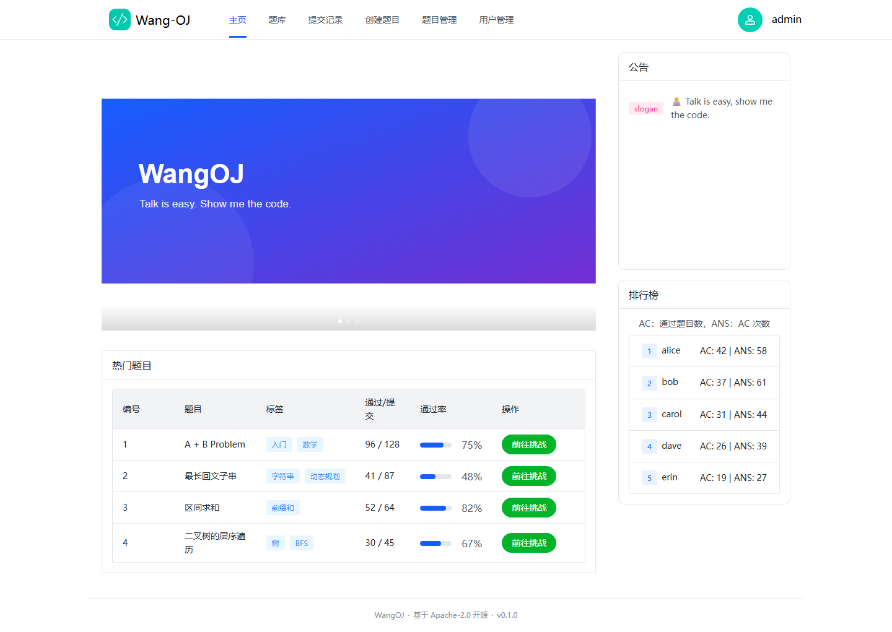
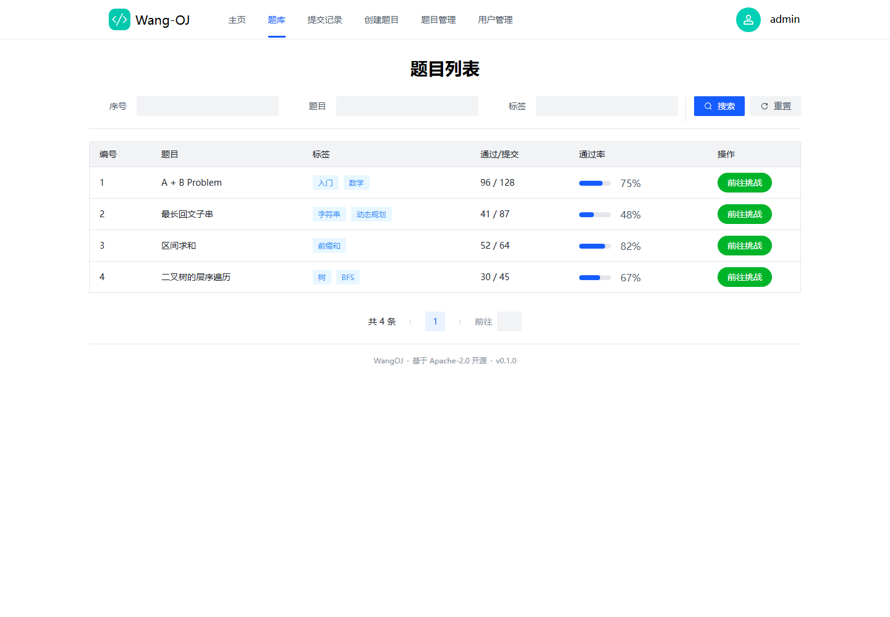
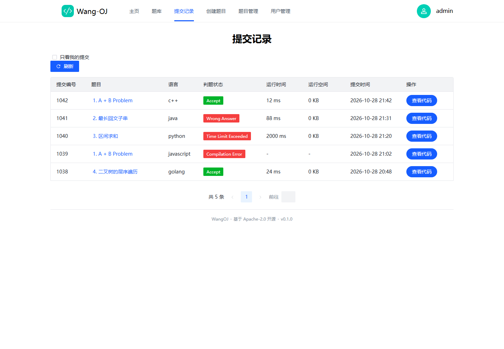
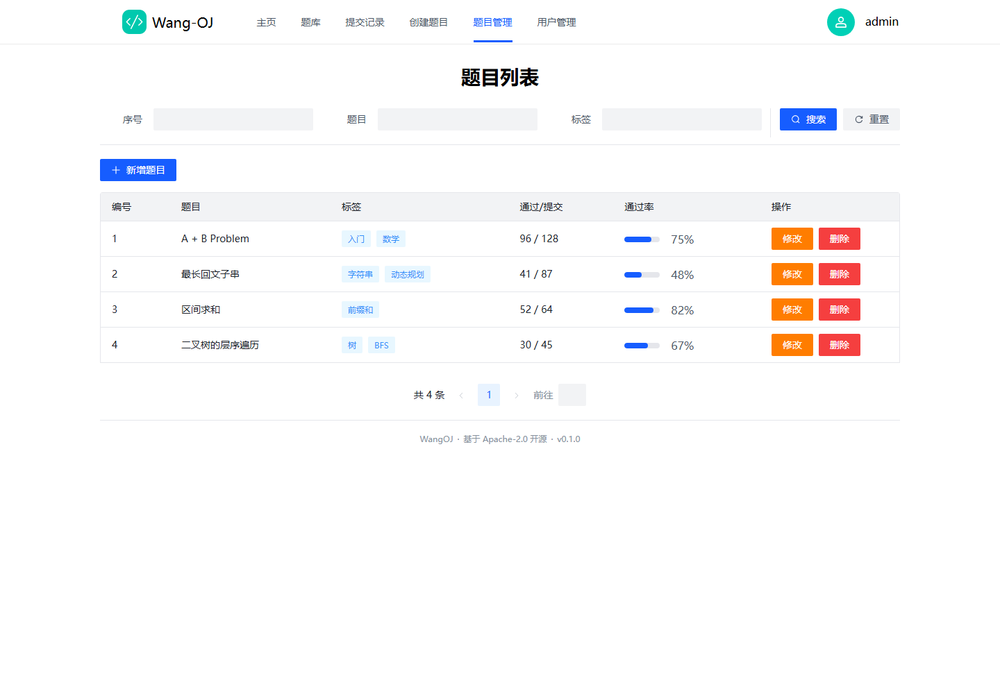
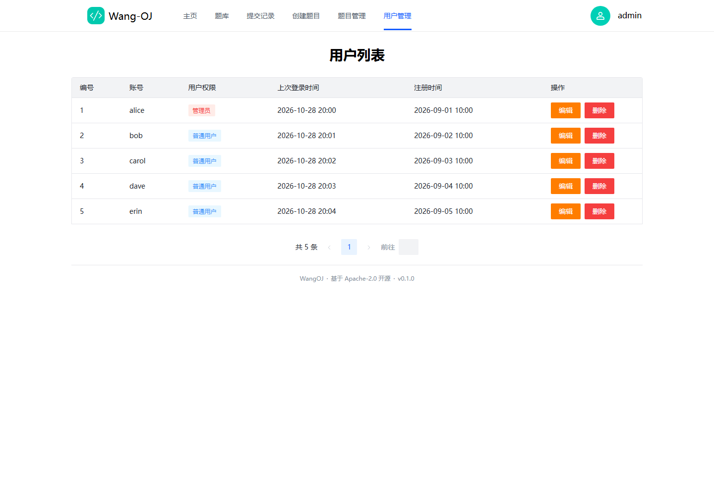
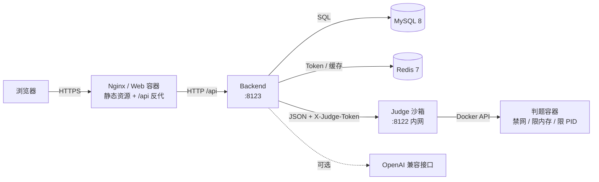

# WangOJ
[](LICENSE)

一个可自托管的在线判题系统（Online Judge）：Spring Boot 后端 + Docker 沙箱判题 + Vue 3 前端。

> 判题代码在隔离容器中执行，支持 C / C++ / Java / Python / JavaScript / Go 六种语言；
> 所有密钥通过环境变量注入，仓库中不含任何真实凭据。

---

## 界面预览

| 首页 | 题库 |
| --- | --- |
|  |  |
| **提交记录** | **题目管理** |
|  |  |
| **用户管理** | |
|  | |

---

## 目录

- [功能](#1-功能)
- [架构](#2-架构)
- [技术栈](#3-技术栈)
- [快速开始](#4-快速开始)
- [配置](#5-配置)
- [初始化管理员](#6-初始化管理员)
- [判题与沙箱](#7-判题与沙箱)
- [生产部署](#8-生产部署)
- [常见问题](#9-常见问题)
- [安全说明](#10-安全说明)
- [贡献](#11-贡献)
- [许可证](#12-许可证)

---

## 1. 功能

**用户侧**

- 注册 / 登录 / 注销，登录状态基于 Redis Token
- 题目列表、标签筛选、搜索、分页
- Markdown 题面渲染
- 在线代码编辑（Ace），六种语言切换
- 提交代码并查看判题结果：`Accept` / `Wrong Answer` / `Time Limit Exceeded` /
  `Memory Limit Exceeded` / `Runtime Error` / `Compilation Error` / `System Error`
- 提交记录、单次提交详情（含代码、耗时、内存）
- 排行榜
- AI 代码解释（可选功能，默认关闭）

**管理员侧**

- 题目增删改查（题面、标签、测试用例、时间/内存限制）
- 用户列表、修改密码、删除用户

---

## 2. 架构



要点：

- **浏览器只与 Web/Nginx 通信**，后端与沙箱都不直接对外；
- **沙箱端口不映射宿主机**，只有后端能访问；
- **沙箱只负责执行，不判断答案**，输出比较在后端完成。

---

## 3. 技术栈

| 模块 | 目录 | 技术 |
| --- | --- | --- |
| 后端 | `src/` | Spring Boot 3.3（EOL，见已知限制）/ Java 17 / MyBatis-Plus 3.5.5 / HikariCP / Knife4j |
| 判题沙箱 | `judge/` | Spring Boot 2.7.18（EOL，见已知限制）/ Java 8 / docker-java 3.3 |
| 前端 | `web/` | Vue 3 / Vite 7 / TypeScript / Pinia / Arco Design / Ace Editor / Bytemd |
| 数据库 | `sql/` | MySQL 8 DDL |
| 部署 | `deploy/`, `docker-compose.yml` | Docker / Nginx |

前端目录只保留源码与配置，说明统一放在本 README：接口以 `/api` 开头，开发环境由 Vite 代理，生产环境由 `web/nginx.conf` 反代。

---

## 4. 快速开始

### 4.1 前置要求

JDK 17、Node.js 20.19+（推荐 20 LTS 最新补丁或 22）、MySQL 8、Redis 7、Docker 24+。

### 4.2 五分钟启动（Docker Compose）

```bash
cp .env.example .env
# 至少修改：DB_ROOT_PASSWORD、DB_PASSWORD、REDIS_PASSWORD、APP_PASSWORD_SALT、JUDGE_TOKEN
# DB_USERNAME 默认 wangoj（compose 会创建该业务账号），不要改成 root
# 生成随机值：openssl rand -hex 32

./judge/backend/install.sh        # 首次需要预拉取判题镜像
docker compose up -d --build
docker compose ps                 # 等 backend / judge 变 healthy
```

打开 <http://127.0.0.1:8080>。

### 4.3 本地开发

```bash
# 1) 依赖
docker run -d --name wangoj-mysql -p 3306:3306 \
  -e MYSQL_ROOT_PASSWORD=devpass -e MYSQL_DATABASE=wangoj mysql:8.0 \
  --character-set-server=utf8mb4 --collation-server=utf8mb4_unicode_ci
docker run -d --name wangoj-redis -p 6379:6379 redis:7-alpine

# 2) 建表
mysql -h127.0.0.1 -uroot -pdevpass < sql/init.sql

# 3) 后端（端口 8123）
cp .env.example .env
# 先替换 .env 里的 __REQUIRED__ 占位值（DB_PASSWORD / REDIS_PASSWORD 等），
# 否则后端会以“口令仍为占位值”拒绝启动
set -a && . ./.env && set +a
mvn spring-boot:run

# 4) 判题沙箱（端口 8122，需要与后端同一个 JUDGE_TOKEN）
#    沙箱是独立 Maven 工程，用 -f 指定 pom
export JUDGE_TOKEN="$(openssl rand -hex 32)"
./judge/backend/install.sh
mvn -f judge/pom.xml spring-boot:run

# 5) 前端（端口 5173，/api 自动代理到 8123）
cd web && npm ci && cp .env.example .env.local && npm run dev
```

### 4.4 测试与构建

本地命令如下（不需要 MySQL / Redis / Docker）：

```bash
# 后端单元测试（含 DTO 校验、异常处理、判题工具）
mvn -B test

# 可选集成测试（需要 Docker，默认被 it 标签排除）
mvn -B -Prun-it -Dtest=JudgeFlowIntegrationTest test

# 沙箱单元测试（不访问 Docker）
mvn -B -f judge/pom.xml test

# 可选：真容器冒烟测试（需要 Docker 与本地 alpine:3.20）
mvn -B -Prun-it -Dtest=DockerSmokeIT -f judge/pom.xml test

# 前端：Vitest + ESLint + 类型检查 + 生产构建
cd web
npm test
npm run lint
npm run build
```

三端单元测试全绿（后端、沙箱、前端）；具体用例数会随迭代变化，以 CI 最新一次运行的
测试报告为准。CI 还会构建 `backend` / `judge` / `web` 三个 Docker 镜像，
避免 Dockerfile 与代码不同构。

---

## 5. 配置

所有配置通过环境变量注入，完整列表见 [`.env.example`](.env.example)。常用项：

| 变量 | 默认值 | 必填 | 说明 |
| --- | --- | --- | --- |
| `DB_URL` | `jdbc:mysql://localhost:3306/wangoj?...` | 否 | JDBC 地址（compose 会自动拼装） |
| `DB_USERNAME` / `DB_PASSWORD` | `wangoj` / 无 | 是 | 数据库账号（compose 会创建该业务账号，不要用 root）；口令至少 12 字符，占位值或过短会导致启动失败 |
| `REDIS_HOST` / `REDIS_PASSWORD` | `localhost` / 无 | 生产必填 | Redis（compose 用 `:?` 强制要求，留空会拒绝启动） |
| `SERVER_PORT` | `8123` | 否 | 后端端口 |
| `APP_CORS_ORIGINS` | `http://localhost:5173` | 否 | 允许跨域的前端来源，逗号分隔；同域反代时无需配置 |
| `APP_PASSWORD_SALT` | 无 | 是 | 密码哈希盐，至少 16 字符，**上线后不可更改**；缺失/占位值会导致启动失败 |
| `JUDGE_URL` | `http://localhost:8122/api/v1/judge` | 是 | 沙箱地址（compose 为 `http://judge:8122/...`） |
| `JUDGE_TOKEN` | 空 | 是 | 与沙箱共享的密钥；未配置时判题被拒绝 |
| `JUDGE_READ_TIMEOUT_MS` | `60000` | 否 | 后端等待沙箱的整体超时；应大于“编译 + 全部测试点”的最长耗时 |
| `APP_AI_ENABLED` | `false` | 否 | AI 功能开关 |
| `AI_API_KEY` / `AI_BASE_URL` / `AI_MODEL` | 空 / `https://api.openai.com` / `gpt-4o-mini` | 否 | AI 接口配置 |
| `APP_AI_RATE_LIMIT_PER_MINUTE` | `10` | 否 | 单个用户每分钟 AI 调用上限，`0` 表示不限制 |
| `KNIFE4J_ENABLE` | `true` | 否 | 是否开放 `/swagger.html`（生产建议 `false`） |
| `JUDGE_PORT` | `8122` | 否 | 沙箱监听端口 |

前端配置见 [`web/.env.example`](web/.env.example)：

| 变量 | 说明 |
| --- | --- |
| `VITE_API_BASE_URL` | 留空表示同源 `/api`（推荐）；跨域部署时填写完整地址 |
| `VITE_PROXY_TARGET` | 仅开发环境：Vite 代理目标，默认 `http://localhost:8123` |

---

## 6. 初始化管理员

系统不内置任何默认密码。注册第一个账号后，用 SQL 把它提升为管理员：

```sql
-- 把 <你的账号> 换成实际注册的账号
UPDATE `user` SET `userRole` = 'admin' WHERE `userAccount` = '<你的账号>';
```

之后即可在前端管理页面维护题目与用户。

---

## 7. 判题与沙箱

- 协议：**HTTP + JSON，请求头 `X-Judge-Token`**，端点 `POST /api/v1/judge`
- 沙箱说明（镜像、安全模型、启动方式）：[judge/README.md](judge/README.md)
- 语言镜像需预拉取（tag 固定）：

  | 语言 | 镜像 |
  | --- | --- |
  | C / C++ | `gcc:13-bookworm` |
  | Java | `eclipse-temurin:17-jdk-alpine` |
  | Python | `python:3.12-alpine` |
  | JavaScript | `node:20-alpine` |
  | Go | `golang:1.22-alpine` |

  ```bash
  ./judge/backend/install.sh          # 全部
  ./judge/backend/install.sh cpp java # 部分
  ```

---

## 8. 生产部署

简要步骤：

1. 准备一台**专用判题机**（判题容器需要 Docker，且判题隔离比业务更重要）；
2. `cp .env.example .env`，把所有 `__REQUIRED__` 替换掉；`APP_PASSWORD_SALT`、`JUDGE_TOKEN` 用 `openssl rand` 生成；
3. `./judge/backend/install.sh` 预拉取镜像；
4. `docker compose up -d --build`；
5. 外层网关（Nginx/Caddy）做 TLS，转发到 `127.0.0.1:8080`；
6. 关闭 API 文档：`KNIFE4J_ENABLE=false`；
7. 配置 MySQL 定时备份。

### 排障与错误码

- 每个响应都带 `X-Request-Id`，可用于在日志中定位一次请求；
- 后端日志格式为 `时间 级别 [requestId] logger - 消息`；
- 判题链路可用 `requestId=commit-<提交ID>-<uuid>` 在后端与沙箱日志中串联。

---

## 9. 常见问题

| 现象 | 排查方向 |
| --- | --- |
| 提交一直 `Waiting` | 后端日志是否调用沙箱失败；`JUDGE_TOKEN` 两端是否一致 |
| 提交变 `System Error` | 沙箱不可达 / 未配置 Token / 镜像未拉取 |
| 判题报“创建判题容器失败” | 运行 `./judge/backend/install.sh`；确认 judge 有 Docker 权限 |
| 前端请求 404 | 后端接口以 `/api` 开头，Nginx 需有 `location /api/` |
| 跨域被拦截 | 同域反代无需 CORS；跨域部署时配置 `APP_CORS_ORIGINS` |
| 登录提示密码错误 | `APP_PASSWORD_SALT` 是否与建库时一致 |
| MySQL 大小写报错 | Linux 下 MySQL 区分表名大小写，请勿改表名 |
| Redis 连接失败 | 检查 `REDIS_HOST` / `REDIS_PASSWORD`，compose 中为 `redis` |

### 已知限制

| 限制 | 说明 |
| --- | --- |
| 后端运行时为 Spring Boot 3.3 | 3.3.x 已结束 OSS 支持（该线最后补丁 3.3.13）；后端承载鉴权、会话与数据库访问，暴露面不小于沙箱，同样属于已披露的技术债 |
| 沙箱运行时为 Spring Boot 2.7 | 2.7.x 已结束 OSS 支持（最后版本 2.7.18）；升级到 3.x 需要 `javax.*` → `jakarta.*` 迁移，列入下一轮计划 |
| Java 用户程序主动 `exit(3)` | 会被判定为 `Memory Limit Exceeded`：沙箱用退出码 3 识别 `-XX:+ExitOnOutOfMemoryError`，无法与用户主动退出区分 |
| 题目标签筛选使用 `LIKE` | 数据量大时无法走普通索引；需要独立标签关联表或 MySQL 8 多值索引 |
| 孤儿容器清理按单实例设计 | 定时任务只保护**本进程**正在判题的容器；多副本共用同一 Docker daemon 时应关闭该任务或改为分布式锁 |
| 原生 Windows 运行沙箱 | 容器内路径拼接使用 `File.separator`，可能产生反斜杠；请使用 Linux 或 Docker Compose 部署 |
| 提交代码默认公开 | 产品策略与信任边界见下节「安全说明」 |

---

## 10. 安全说明

- **不要把 8122 端口暴露到公网或宿主机**；沙箱只应被后端访问。
- 判题容器已启用：禁网、内存/swap 限制、PID 限制、`cap-drop ALL`、
  `no-new-privileges`、文件大小与句柄数限制，超时后 kill 进程。
- 仓库中**不含**任何真实密钥；`.env` 已被 `.gitignore` 忽略。
- 日志不记录用户代码与完整输入输出。
- **提交代码默认公开**：`GET /api/log/{id}` 不要求登录，任何人可读任意提交的源代码
  与运行结果（业界 OJ 惯例）。如果你的实例需要私有提交，请自行收紧。
- 题目的**测试用例与标准答案从不下发**（沙箱只执行代码、判定在后端完成）。
- 若发现安全问题，请勿公开提交 Issue，请改为私下联系维护者。

---

## 11. 贡献

欢迎 Issue 与 PR。

---

## 12. 许可证

本项目以 [Apache License 2.0](LICENSE) 发布。

本仓库包含两部分上游代码，归属与许可证全文分别如下：

- `judge/` 目录基于 [code-judge](https://github.com/kk-OJ/code-judge)（Apache-2.0）修改而来，
  上游许可证全文见 [`judge/LICENSE`](judge/LICENSE)；
- `web/src/` 的前端界面与样式改编自
  [Arco Design Pro](https://github.com/arco-design/arco-design-pro-vue)（MIT，
  Copyright (c) 2021 Bytedance, Inc. and its affiliates），
  上游许可证全文见 [`web/LICENSE-ARCO-PRO`](web/LICENSE-ARCO-PRO)。
